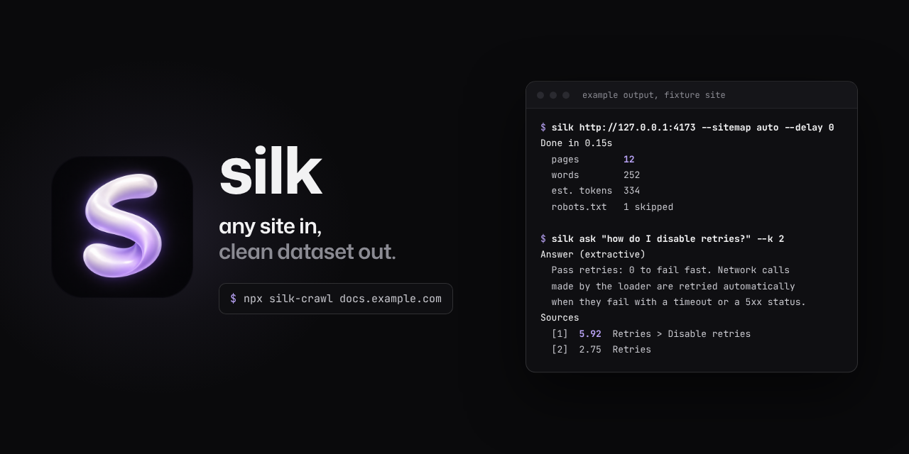
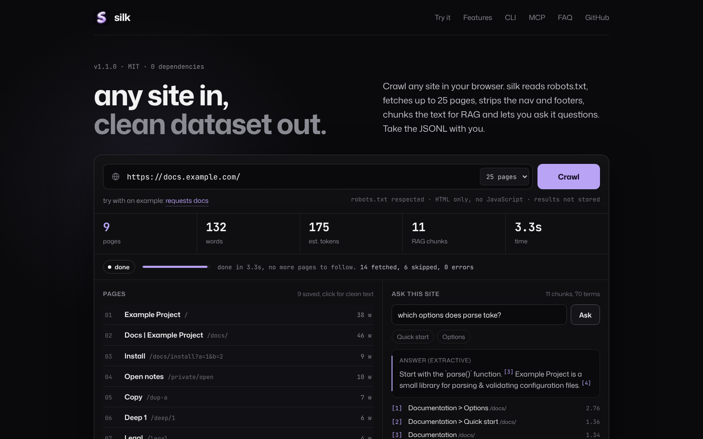
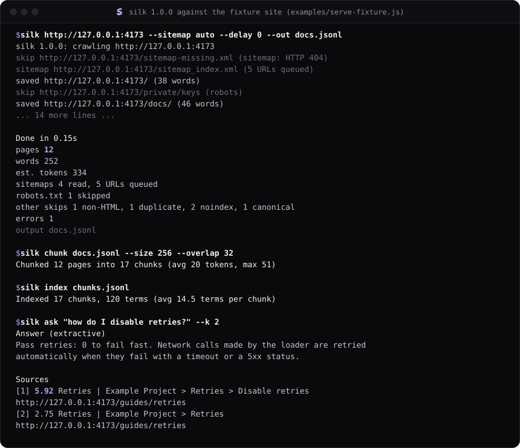
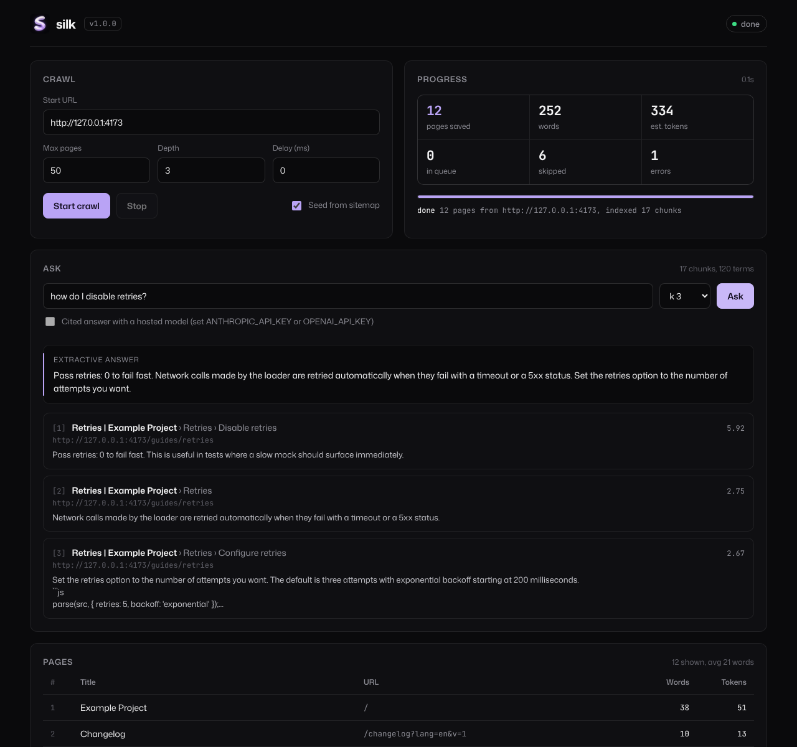

<p align="center">
  
</p>

<h1 align="center">
  &nbsp;silk
</h1>

<p align="center"><strong>any site in, clean dataset out.</strong></p>

<p align="center">
  <a href="LICENSE"></a>
  <a href="https://nodejs.org"></a>
  <a href="package.json"></a>
  <a href="#use-it-from-an-ai-agent"></a>
</p>

<p align="center">
  <a href="#use-it-in-your-browser">Try it in your browser</a> &middot;
  <a href="#quick-start">Quick start</a> &middot;
  <a href="#cli-reference">CLI</a> &middot;
  <a href="#use-it-from-an-ai-agent">MCP</a> &middot;
  <a href="#dashboard">Dashboard</a> &middot;
  <a href="#programmatic-api">API</a> &middot;
  <a href="https://silkcrawl.dev">Website</a> &middot;
  <a href="CHANGELOG.md">Changelog</a>
</p>

Point silk at a docs site and you get one JSONL line per page. It reads
robots.txt first, crawls at the pace the site asks for and drops the nav,
footers and scripts. Then `silk chunk`, `silk index` and `silk ask` turn that
file into RAG chunks and a local BM25 index you can query from the terminal, a
dashboard on 127.0.0.1 or your agent over MCP. Zero dependencies, Node 18+.

## Use it in your browser

**[silkcrawl.dev](https://silkcrawl.dev)**: paste a site address and press Crawl. No install.

- silk's own crawler runs on a serverless function: robots.txt first, then up to 25 pages from the same site within 45 seconds. Pages stream into the page as they land, with live counts of pages, words and estimated tokens.
- Click any page to see its clean text.
- **Ask this site**: the RAG chunks are indexed with silk's BM25 search inside your tab and answer questions with cited sources.
- **Download JSONL** and **Download RAG chunks** give you `pages.jsonl` and `chunks.jsonl` in the same format as `silk` and `silk chunk`.
- Links are shareable: `https://silkcrawl.dev/?url=docs.example.com&max=25` runs the crawl on load.

The hosted crawler only fetches public `http(s)` sites on ports 80 and 443 (private, loopback and link-local addresses are refused, every redirect is re-checked), caps pages at 2 MB, and is rate limited per network. Results are not stored. For bigger crawls, sitemaps or resume, run the CLI.

<p align="center"></p>

## Why

Getting a website into an LLM usually means a hosted scraping API or a
framework with 200 packages in `node_modules`. silk is one package with zero:

- **One command per stage, one file per stage.** `dataset.jsonl`, `chunks.jsonl`, `silk.index.json`. All plain text, so you can grep it, diff it and commit it.
- **Polite by default.** robots.txt, Crawl-delay, per-host spacing, `noindex`, `nofollow` and canonical links all work with zero flags.
- **Nothing to host.** `npx silk-crawl` and you are running. Search runs locally with no model and no network.
- **Works from your agent.** `silk mcp` exposes the same pipeline as 4 MCP tools, so Claude, Cursor or any MCP client can crawl and query a site itself.

## Features

| | |
| --- | --- |
| **Polite crawler** | Breadth-first, per-host rate limits, RFC 9309 robots.txt (longest match, wildcards, Crawl-delay), redirects, 5 MB page cap. |
| **Sitemap seeding** | `--sitemap auto` reads robots.txt `Sitemap:` lines or `/sitemap.xml`, follows sitemap indexes and gzip sitemaps. |
| **Resume** | `--resume` skips URLs and text hashes already in the output file and appends the rest. |
| **Clean extraction** | Removes nav, footers, asides, forms, scripts. Keeps headings, lists and fenced code blocks as markdown. |
| **Dedupe** | URL normalisation plus SHA-256 of the text catches mirrors, print views and tracking-parameter copies. |
| **RAG chunking** | Token-aware (`words * 1.33`), splits on headings, then paragraphs, then sentences, with overlap. Keeps URL, title and heading path. |
| **Local search brain** | BM25 index in one JSON file. Tokenizer with stopwords, light stemming and camelCase splitting. Extractive answers. |
| **Cited LLM answers** | Optional `--llm` sends the top passages to Anthropic or OpenAI and asks for an answer with `[n]` citations. |
| **Exports** | Clean JSONL, a Markdown folder (one file per page), or a Hugging Face dataset folder with a generated card. |
| **Stats** | Pages, words, tokens, length distribution, top domains, duplicate rate. |
| **MCP server** | `silk mcp`: `crawl_site`, `chunk_dataset`, `search_index`, `dataset_stats`. |
| **Dashboard** | `silk ui`: start crawls, watch progress, browse pages, ask questions. One local HTML page, no CDN. |

## Demo

A real session against the fixture site that ships with the tests
(`node examples/serve-fixture.js`). Example data:

<p align="center"></p>

## Install

Run without installing:

```sh
npx silk-crawl https://docs.example.com
```

Or install the `silk` command globally:

```sh
npm install -g silk-crawl
```

The npm package is `silk-crawl`; the command it installs is `silk`. Node 18 or newer, no other requirements.

## Quick start

```sh
# 1. Crawl: pages to JSONL, seeded from the site's sitemaps
silk https://docs.example.com --sitemap auto --max-pages 200 --out dataset.jsonl

# 2. Chunk for retrieval
silk chunk dataset.jsonl --size 512 --overlap 64 --out chunks.jsonl

# 3. Build the local search index
silk index chunks.jsonl --out silk.index.json

# 4. Ask
silk ask "how do I configure retries?" --index silk.index.json --k 5
```

Output of step 4 against the fixture site (example data):

```console
$ silk ask "how do I disable retries?" --k 2
Answer (extractive)
  Pass retries: 0 to fail fast. Network calls made by the loader are retried
  automatically when they fail with a timeout or a 5xx status.

Sources
  [1]  5.92  Retries | Example Project > Retries > Disable retries
            http://127.0.0.1:4173/guides/retries
  [2]  2.75  Retries | Example Project > Retries
            http://127.0.0.1:4173/guides/retries
```

Set `ANTHROPIC_API_KEY` or `OPENAI_API_KEY` and add `--llm` to get a written
answer that cites the numbered sources instead of the extractive one.

## CLI reference

```
silk <url> [options]                 crawl a site to JSONL (same as "silk crawl")
silk chunk <dataset.jsonl> [options] cut pages into chunks for RAG
silk index <chunks.jsonl> [options]  build a local BM25 index, one JSON file
silk ask "<question>" [options]      search the index, get passages and an answer
silk export <dataset.jsonl> [opts]   jsonl, a markdown folder or a Hugging Face folder
silk stats <dataset.jsonl>           pages, words, tokens, domains, dupes
silk ui [--port 4321]                local dashboard on 127.0.0.1
silk mcp                             MCP server on stdio for Claude, Cursor and co
```

Every command accepts `--json` (machine-readable output), `--quiet`, `-h/--help` and `-v/--version`.
Options that do not belong to a command are rejected.

### `silk <url>` / `silk crawl <url>`

| Option | Default | Description |
| --- | --- | --- |
| `--max-pages <n>` | `50` | Maximum pages to save in this run. |
| `--depth <n>` | `3` | Maximum link depth from the start URL (sitemap entries start at depth 0). |
| `--concurrency <n>` | `2` | Requests in flight at once. |
| `--delay <ms>` | `500` | Minimum time between two requests to one host. A larger robots.txt `Crawl-delay` wins. |
| `--out <file>` | `dataset.jsonl` | Output file. `-` writes JSONL to stdout. |
| `--sitemap <src>` | | `auto`: robots.txt `Sitemap:` lines, else `/sitemap.xml`. Or a sitemap URL. |
| `--resume` | | Read `--out`, skip its URLs and text hashes, append new records. |
| `--same-host <bool>` | `true` | Only follow links on the start URL's host. |
| `--include <regex>` | | Only queue discovered URLs that match. |
| `--exclude <regex>` | | Never queue discovered URLs that match. |
| `--user-agent <ua>` | `silk/1.1.0 (+https://github.com/OWNER/silk)` | User-Agent header and robots.txt identity. |
| `--timeout <ms>` | `15000` | Per-request timeout. |

A URL without a scheme gets `https://`. The start URL is always fetched; filters
apply to discovered links and sitemap entries. Exit codes: `0` when pages were
saved (or a resumed file is already complete), `1` when nothing was saved or a
runtime error occurred, `2` for invalid arguments.

**Resume.** With `--resume`, silk reads the output file first. With `--sitemap`,
known pages are skipped without a request, because the sitemap already lists
every page. Without a sitemap, known pages are still fetched to discover their
links, but never written again.

One page record:

```json
{
  "url": "http://127.0.0.1:4173/docs/",
  "title": "Docs | Example Project",
  "text": "# Documentation\n\nWelcome to the docs. Start with the `parse()` function.\n\n## Quick start\n\n```js\nimport { parse } from 'example';\nconst cfg = parse('a = 1');\nif (cfg.a < 2) console.log(cfg);\n```\n\n## Options\n\n- strict: fail on unknown keys\n- env: expand environment variables",
  "headings": ["Documentation", "Quick start", "Options"],
  "links_out": 4,
  "words": 46,
  "tokens_est": 61,
  "fetched_at": "2026-10-14T00:42:45.971Z",
  "sha256": "176bd4a87e4f2feb3d4ef7980bd263e89aef840c7508b2e7ca8aa6c7e70734fb"
}
```

| Field | Description |
| --- | --- |
| `url` | Final URL after redirects, fragment removed, query sorted. |
| `title` | `<title>`, or the first heading when there is none. |
| `text` | Clean text with `#` headings, `-` list items and fenced code blocks. |
| `headings` | All `h1` to `h6` texts in document order. |
| `links_out` | Unique http(s) links found on the page. |
| `words`, `tokens_est` | Word count and `round(words * 1.33)`. An estimate, not a tokenizer. |
| `fetched_at` | ISO 8601 timestamp. |
| `sha256` | SHA-256 of `text`, used for deduplication and resume. |

### `silk chunk`

| Option | Default | Description |
| --- | --- | --- |
| `--size <tokens>` | `512` | Maximum estimated tokens per chunk (minimum 16). |
| `--overlap <tokens>` | `64` | Tokens carried from the end of one chunk into the next within a section. Must be smaller than `--size`. |
| `--out <file>` | `chunks.jsonl` | Output file. |

Splitting order: headings first (every chunk sits under exactly one heading
path), then paragraphs (a fenced code block counts as one paragraph), then
sentences, and words only for a single sentence larger than `--size`. One
chunk from the fixture site (`--size 256 --overlap 32`):

```json
{
  "id": "9860c6ff4677-1",
  "url": "http://127.0.0.1:4173/guides/retries",
  "title": "Retries | Example Project",
  "heading_path": ["Retries", "Configure retries"],
  "chunk_index": 1,
  "text": "## Configure retries\n\nSet the retries option to the number of attempts you want. The default is three attempts with exponential backoff starting at 200 milliseconds.\n\n```js\nparse(src, { retries: 5, backoff: 'exponential' });\n```",
  "words": 35,
  "tokens_est": 47
}
```

### `silk index`

| Option | Default | Description |
| --- | --- | --- |
| `--out <file>` | `silk.index.json` | Index file. |

Builds a BM25 index (k1 = 1.2, b = 0.75) over title, heading path and text of
each chunk. Page records from `silk crawl` work too; each page is then one
document.

### `silk ask`

| Option | Default | Description |
| --- | --- | --- |
| `--index <file>` | `silk.index.json` | Index to search. |
| `--k <n>` | `5` | Passages to return. |
| `--llm` | | Ask a hosted model for a cited answer (see [Configuration](#configuration)). |

The extractive answer picks up to three sentences from the top passages that
share the most distinct terms with the question. `--json` returns
`{ question, answer, passages: [{ score, id, url, title, heading_path, chunk_index, text }], llm? }`.

### `silk export`

| Option | Default | Description |
| --- | --- | --- |
| `--format <f>` | `jsonl` | `jsonl`, `markdown` or `hf`. |
| `--out <path>` | `export.jsonl`, `export-md`, `hf-dataset` | File (jsonl) or folder (markdown, hf). |
| `--name <name>` | `silk-dataset` | Dataset name for the `hf` card. |

All formats drop records that repeat a URL or text hash and add an `id`.
`markdown` writes one `.md` per page (`guides/retries` becomes `guides-retries.md`)
with YAML front matter. `hf` writes `data/train.jsonl` and a `README.md` dataset
card with metadata, statistics, source domains and the field list.

### `silk stats`

```console
$ silk stats docs.jsonl
docs.jsonl
  pages          12
  words          252
  est. tokens    334
  avg length     21 words (median 9.5, min 4, max 77)
  duplicates     0 (0.0%)
  domains        1
    127.0.0.1:4173               12
```

`--top <n>` sets how many domains are listed. Duplicates are records whose URL
or text hash appeared earlier in the file.

## Use it from an AI agent

`silk mcp` runs a [Model Context Protocol](https://modelcontextprotocol.io)
server over stdio (JSON-RPC 2.0, one message per line; logs go to stderr).
Add it to Claude Desktop (`claude_desktop_config.json`), Claude Code
(`.mcp.json`) or Cursor (`.cursor/mcp.json`):

```json
{
  "mcpServers": {
    "silk": {
      "command": "npx",
      "args": ["-y", "silk-crawl", "mcp"]
    }
  }
}
```

With Claude Code you can also run `claude mcp add silk -- npx -y silk-crawl mcp`.

| Tool | Arguments | Returns |
| --- | --- | --- |
| `crawl_site` | `url`, `max_pages` (1 to 200, default 20), `depth`, `sitemap`, `include`, `exclude`, `delay_ms`, `out`, `max_chars` | Crawl summary plus `records`. Without `out`, records include text (truncated to `max_chars`); with `out`, records are written to that JSONL file. |
| `chunk_dataset` | `path`, `out`, `size`, `overlap`, `index_out` | Chunk counts; with `index_out` also builds the index. |
| `search_index` | `index`, `question`, `k`, `llm` | Ranked passages and the extractive (or LLM) answer. |
| `dataset_stats` | `path` | The `silk stats` object. |

Tool failures (a missing file, an unreachable site) come back as results with
`isError: true`; unknown tools and bad arguments are JSON-RPC errors `-32602`.
A quick manual check (output trimmed):

```console
$ echo '{"jsonrpc":"2.0","id":1,"method":"initialize","params":{"protocolVersion":"2025-06-18"}}' | silk mcp
silk 1.1.0 MCP server ready on stdio
{"jsonrpc":"2.0","id":1,"result":{"protocolVersion":"2025-06-18","capabilities":{"tools":{}},"serverInfo":{"name":"silk","version":"1.1.0"}}}
```

## Dashboard

```sh
silk ui --port 4321 --dir silk-data
# silk 1.1.0 dashboard: http://127.0.0.1:4321
```

Open the printed URL. Start a crawl (sitemap seeding is on by default), watch
the counters and the page table fill, then ask the index. When a crawl finishes the
dashboard chunks the dataset and builds the index in `--dir` automatically
(`dataset.jsonl`, `chunks.jsonl`, `silk.index.json`). Restarting with the same
`--dir` reloads them; `--index <file>` loads an existing index instead. Click a
page row to read its extracted text.

<p align="center"></p>
<p align="center"><sub>Example data: the fixture site from the test suite.</sub></p>

The page talks to a small JSON API you can script against:

| Endpoint | Description |
| --- | --- |
| `GET /api/state` | Crawl status and counters, the last 500 pages, totals, index info. |
| `POST /api/crawl` | `{ url, maxPages, depth, delay, sitemap, include, exclude }`. One crawl at a time (409 otherwise). |
| `POST /api/stop` | Stop the running crawl after requests in flight. |
| `POST /api/ask` | `{ question, k, llm }`. |
| `GET /api/page?url=` | The full record for one page. |

The server binds to 127.0.0.1 and only accepts `application/json` POST bodies.

## Programmatic API

```js
import { crawl, chunkRecords, buildIndex, ask } from 'silk-crawl';

const job = crawl('https://docs.example.com', { maxPages: 100, sitemap: 'auto' });
const pages = [];
for await (const page of job) pages.push(page);
console.log(job.stats); // { pages, words, tokens, fetched, sitemaps, sitemapUrls, known, robotsSkipped, ... }

const chunks = chunkRecords(pages, { size: 512, overlap: 64 });
const index = buildIndex(chunks); // plain JSON, safe to JSON.stringify to disk
const { answer, passages } = ask(index, 'how do I configure retries?', { k: 5 });
```

`examples/api.js` runs exactly this. Against the fixture site with the question
"how is the cache invalidated?" it prints (example data):

```
Q: how is the cache invalidated?
A: Call clearCache() after editing a file programmatically. The cache never stores secrets expanded from environment variables. Parsed configuration is cached in memory by file path and modification time.

  6.25  Caching | Example Project > Caching > Cache invalidation  http://127.0.0.1:4173/guides/caching
  3.31  Caching | Example Project > Caching  http://127.0.0.1:4173/guides/caching
```

| Export | Purpose |
| --- | --- |
| `crawl(url, options)` | Async iterable of page records with live `.stats` and `.stop()`. Options mirror the CLI flags in camelCase, plus `known: { urls, hashes }`, `onProgress(event)` and `fetch`. |
| `crawlToFile(url, { out, resume, ...options })` | Crawl straight to a JSONL file, with resume. |
| `chunkRecords(records, { size, overlap })`, `chunkText`, `sections` | Chunking. |
| `buildIndex(chunks)`, `search(index, query, { k })`, `ask(index, question, { k })`, `extractiveAnswer` | Search. |
| `llmAnswer(question, passages, { env })`, `llmProvider(env)` | Hosted model answers. |
| `datasetStats(records)`, `exportDataset(records, { format, out, name })`, `datasetCard` | Stats and export. |
| `parseSitemap(xml)`, `readSitemaps(urls, { request })`, `robotsSitemaps(text, base)` | Sitemaps. |
| `extract(html, url)`, `Robots`, `parseRobots`, `toFetchUrl`, `urlKey` | Building blocks from 0.1. |
| `tokenize`, `stem`, `sentences`, `estimateTokens` | Text utilities. |
| `serveMcp()`, `startDashboard({ port, dir })` | Servers. |

## How it works

```mermaid
flowchart LR
  A[Start URL] --> R{robots.txt}
  R -- Sitemap lines --> S[sitemap.xml and indexes]
  S --> F[Frontier]
  A --> F
  F --> P[Polite fetch: per-host delay, Crawl-delay]
  P --> X[Extract: drop boilerplate, keep headings, lists, code]
  X -- links --> F
  X --> D[Dedupe: URL key + SHA-256]
  D --> J[(dataset.jsonl)]
  J --> C[Chunk: headings, paragraphs, sentences, overlap]
  C --> K[(chunks.jsonl)]
  K --> I[BM25 index]
  I --> N[(silk.index.json)]
  N --> Q[ask: ranked passages + extractive answer]
  Q -.-> L[Optional, with --llm: cited answer from Anthropic or OpenAI]
```



1. **Frontier.** Breadth-first queue seeded with the start URL and, with `--sitemap`, every URL from the sitemaps. URLs are normalised (fragments and credentials removed, query sorted, trailing slash folded) before deduplication.
2. **robots.txt.** Fetched once per origin and parsed per RFC 9309: the most specific `User-agent` group applies, the longest `Allow`/`Disallow` match wins, `Allow` wins ties, `*` and `$` work. `Sitemap:` lines are read regardless of group.
3. **Politeness.** Each host has its own schedule spaced by `--delay` or `Crawl-delay` (capped at 60 s), whichever is larger. Concurrency never shortens it.
4. **Directives.** `noindex` pages are not saved, `nofollow` pages contribute no links, a canonical link pointing elsewhere redirects the crawl to the canonical URL.
5. **Extraction.** Scripts, styles, nav, footer, aside and forms are removed; `<main>` or `<article>` is preferred; headings, lists, inline code and `<pre>` blocks become markdown.
6. **Chunking.** Sections by heading, packed with paragraphs up to `--size` estimated tokens, with `--overlap` tokens repeated at each split.
7. **Search.** Tokens are lowercased, stopwords dropped, suffixes stemmed (`crawling`, `crawled`, `crawls` become `crawl`) and camelCase split. BM25 ranks chunks; the answer is the best-matching sentences from the top passages.

## Configuration

| Variable | Used by | Description |
| --- | --- | --- |
| `ANTHROPIC_API_KEY` | `--llm`, MCP `llm: true`, dashboard | Enables Anthropic. Preferred when both keys are set. |
| `OPENAI_API_KEY` | same | Enables OpenAI. |
| `SILK_LLM_PROVIDER` | same | Force `anthropic` or `openai`. |
| `SILK_LLM_MODEL` | same | Model name. Defaults: `claude-haiku-5-5` (Anthropic), `gpt-4o-mini` (OpenAI). |
| `ANTHROPIC_BASE_URL` | same | API base, default `https://api.anthropic.com` (requests go to `/v1/messages`). |
| `OPENAI_BASE_URL` | same | API base, default `https://api.openai.com/v1` (requests go to `/chat/completions`). Works with OpenAI-compatible servers. |
| `PORT` | `examples/serve-fixture.js` | Port of the local fixture site, default 4173. |

The website (`docs/` plus `api/crawl.js`, deployed on Vercel) needs no environment variables. To run it locally against the fixture site:

```bash
node scripts/dev-site.mjs --fixture
# silk site: http://127.0.0.1:3000
# fixture:   http://127.0.0.1:41234  (try http://127.0.0.1:3000/?url=...)
```

`--fixture` lets the local crawler reach 127.0.0.1, which the deployed function refuses.

## FAQ

**Does silk run JavaScript?** No. It reads the HTML the server sends. Docs sites, blogs and whitepapers usually render on the server. Client-rendered single-page apps come out thin.

**How accurate are the token counts?** They are estimates (`words * 1.33`), close for English prose with common tokenizers. Chunk sizes use the same estimate, so leave headroom if your embedding model has a hard limit.

**Is the search semantic?** No, it is lexical BM25. No model, no network. For semantic retrieval, feed `chunks.jsonl` to your embedding pipeline; the chunk metadata (URL, heading path) carries over.

**What is sent to the model with `--llm`?** The question and the top `k` passages, nothing else. Without `--llm` the only network traffic is the crawl itself.

**Can I crawl any site?** silk follows robots.txt and rate limits, but it can't read terms of service or licenses. Check them before crawling a site or publishing a dataset made from it.

**Why `silk-crawl` on npm?** The name `silk` was taken. The command is still `silk`.

**What is $SILK?** The project's community token. The software is MIT licensed and works the same with or without it. Nothing here is financial advice.

## Roadmap

- [ ] Honour the `charset` from `Content-Type` and `<meta charset>` for non-UTF-8 pages.
- [ ] Sitemap `<lastmod>` aware recrawls: refetch only pages changed since the last run.
- [ ] PDF text extraction behind an opt-in flag.
- [ ] Optional embeddings export (`silk embed`) for providers with an embeddings API, stored next to the BM25 index.
- [ ] Hybrid ranking (BM25 plus embeddings) in `silk ask` when embeddings exist.
- [ ] Parquet output for `silk export --format hf`.

## Contributing

Issues and pull requests are welcome. The test suite (31 tests) runs fully
offline against a local fixture site and local mock servers:

```sh
npm test
```

See [CONTRIBUTING.md](CONTRIBUTING.md). Please read the [code of conduct](CODE_OF_CONDUCT.md)
and report security issues as described in [SECURITY.md](SECURITY.md).

## License

[MIT](LICENSE)
